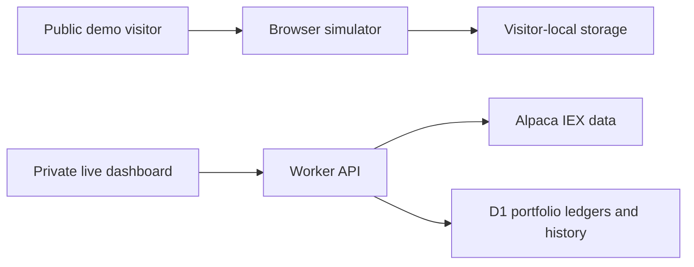

# Ledger Portfolio Lab

A stock portfolio simulator with two implementations: a public synthetic demo
that anyone can try, and a server-backed application that integrates Alpaca IEX
market data with persistent paper-trading portfolios.

**[Try the public demo](https://ledger-portfolio-demo.genialchub16384.chatgpt.site)**
· **[Engineering walkthrough](https://ledger-portfolio-demo.genialchub16384.chatgpt.site/employer-guide.html)**

The public demo uses synthetic prices and virtual money. The live-data version
is demonstrated privately; this repository contains its source, not credentials
or private portfolio records.

## What it demonstrates

- API integration: server-side Alpaca IEX snapshots and historical daily bars,
  quote timestamps, explicit exchange coverage, and provider failure handling.
- Trading logic: named paper accounts, cash and share validation, average cost,
  holdings, returns, conditional writes, and duplicate-request protection.
- Persistence: D1 ledgers and observed daily valuations in the live application;
  isolated device-local records in the public simulator.
- Visualization: stock charts, starting-capital comparisons, activity history,
  exports, and reproducible scenarios covering up to five years.
- Verification: Node tests for financial invariants, date boundaries, concurrent
  requests, deterministic prices, account isolation, and stale-data behavior.

## Project layout

| Directory | Purpose | Stack |
| --- | --- | --- |
| `public-demo/` | Public synthetic simulator | Browser-native JavaScript, HTML, CSS, SVG, local storage |
| `live-app/` | Server-backed paper trading app | React, TypeScript, Vinext, Cloudflare Workers, D1, Alpaca IEX |



## Run the public demo

No dependency installation or API key is required.

```sh
python -m http.server 8080 --directory public-demo/dist
```

Open `http://localhost:8080`. Advance virtual time, place a paper order, create
another named account, or generate a longer test scenario. Each visitor's data
stays in their browser unless exported.

```sh
cd public-demo
node --test tests/*.test.mjs
```

Use Node 24 for the tests.

## Run the live-data application

See [live-app/README.md](live-app/README.md) for Node and Docker setup and
[live-app/lib/API.md](live-app/lib/API.md) for the API contract. Create your own
Alpaca paper account and set `ALPACA_API_KEY` and `ALPACA_API_SECRET` in a local
`.dev.vars` file copied from the blank example. Hosted environments use secret
runtime variables. Never commit either credential.

The source's hosting manifests intentionally omit deployment identity. Set up
your own hosting and database; no production resources or data are included.
The daily schedule described in the live-app documentation belongs to the
original deployment and is not created automatically by cloning this repository.

## Validation

The live application passed 18 Node tests locally and in Docker, TypeScript
checks, and production builds. The public engine passed four grouped Node tests
covering long histories, cent-exact valuations, trading rules, and isolated
state. GitHub Actions runs both projects' checks on pushes and pull requests.
Browser checks covered account selection, selected-stock prices, virtual orders,
scenario generation, and time advancement.

## Data boundaries

The free IEX feed covers one exchange, not consolidated US market activity.
Quotes refresh by polling; stale quotes cannot fill live paper orders. Price
charts use daily bars. Actual live performance history begins with saved
observations, while generated performance is explicitly synthetic.

Virtual fills omit commissions, spread, slippage, dividends, and corporate
actions. Momentum screens explain historical price movement; they are not
forecasts or personalized investment recommendations. No real brokerage orders
are placed by either application.
